# Time-Deck: Free Full-Screen Clock, Countdown Timer, Stopwatch & World Clock

[](https://github.com/chrisjdj/Time-Deck/actions/workflows/deploy.yml)
[](LICENSE)


Time-Deck shows full-screen clocks, countdowns, stopwatches, world clocks and stage timers on any screen: a laptop, TV, projector or OBS stream. You set it up from a dashboard. It runs entirely in your browser with **no server, no account and no tracking**, and it works offline as an installable PWA.

### [▶ Open Time-Deck](https://chrisjdj.github.io/Time-Deck/)

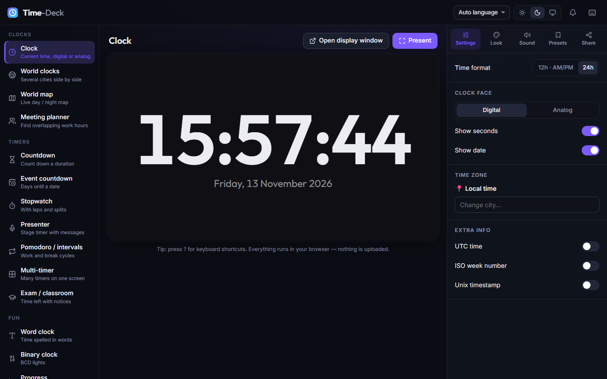

## Contents

- [Features](#features)
- [Screenshots](#screenshots)
- [Use cases](#use-cases)
- [Display & styles](#display--styles)
- [Keyboard shortcuts](#keyboard-shortcuts)
- [Sharing, second screen & OBS overlay](#sharing-second-screen--obs-overlay)
- [Privacy](#privacy)
- [How time is kept](#how-time-is-kept)
- [Development](#development)
- [Deployment](#deployment)
- [Contributing](#contributing)
- [Credits](#credits)

## Features

| Group | Mode | What it does |
|---|---|---|
| Clocks | Clock | Digital or analog, seconds and date, any city, optional UTC / ISO week / Unix time |
| | World clocks | Up to 12 cities in an auto grid, offset vs local time, tomorrow/yesterday, day/night tint, sunrise & sunset |
| | World map | Live day/night terminator, subsolar point and city pins (computed offline) |
| | Meeting planner | 24h strips per city with working hours, overlap highlight, click-to-select + copy, time converter |
| Timers | Countdown | Duration with quick chips, progress ring, amber/red thresholds, overtime count-up |
| | Event countdown | Days/hours/minutes to a date in any time zone, then "time since" |
| | Stopwatch | Centiseconds, laps with lap/split, best/worst highlight, CSV export |
| | Presenter | Agenda segments, colour thresholds, overtime flash, live messages to the speaker |
| | Pomodoro / intervals | Pomodoro sets or custom HIIT-style intervals with repeat |
| | Multi-timer | Up to 12 independent countdowns/stopwatches, tap a tile to start/pause |
| | Exam / classroom | Manual or fixed start/end, reading time, spoken milestones, notice board |
| Fun | Word clock · Binary clock · Progress (day/week/month/year) · Moon phase | |

**Alarms and "remind me in X" reminders** work on top of any mode. They ring only while a Time-Deck tab is open.

The interface is available in English, Spanish, French and German, and supports 12-hour (AM/PM) and 24-hour time.

## Screenshots

| | |
|---|---|
| 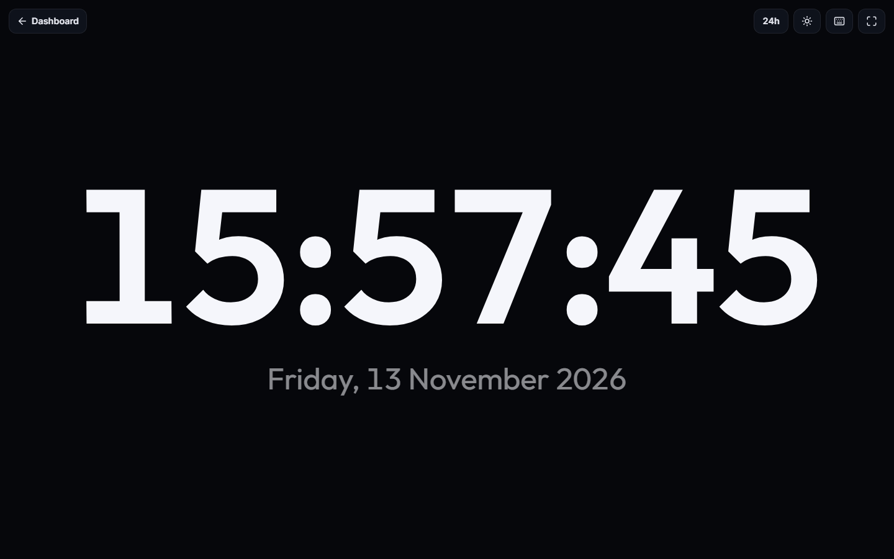 **Clock** | 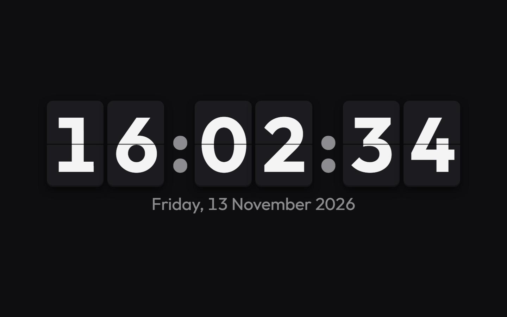 **Clock, Flip style** |
| 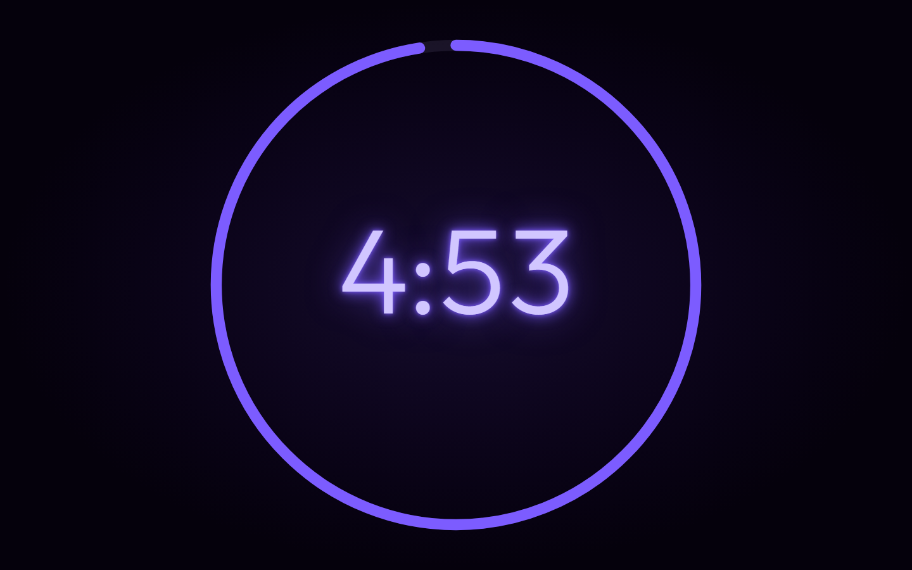 **Countdown, Neon style** | 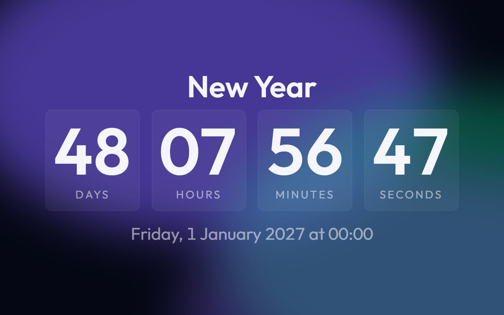 **Event countdown, Aurora style** |
| 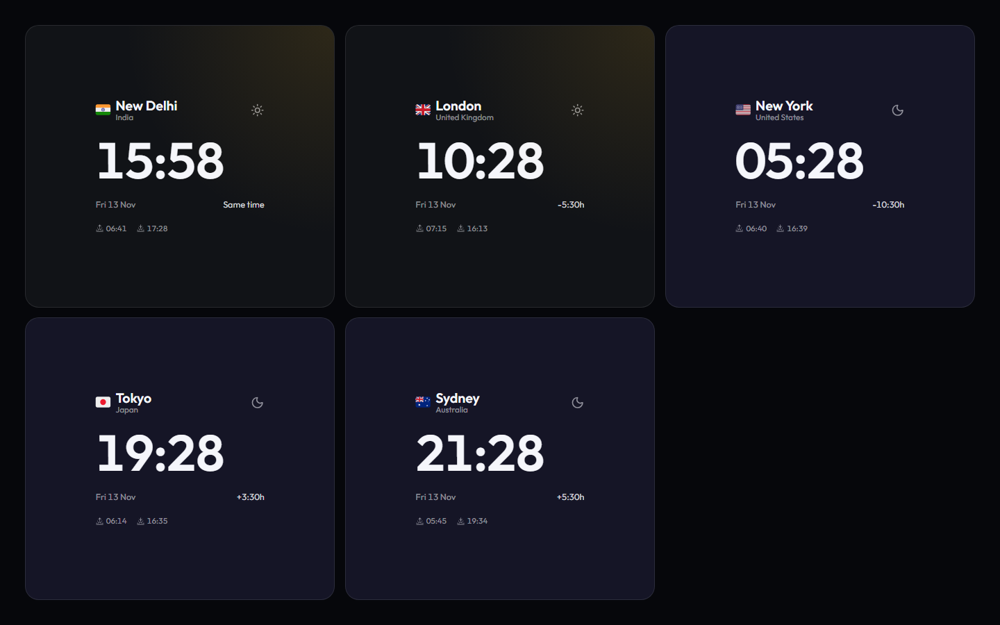 **World clocks** | 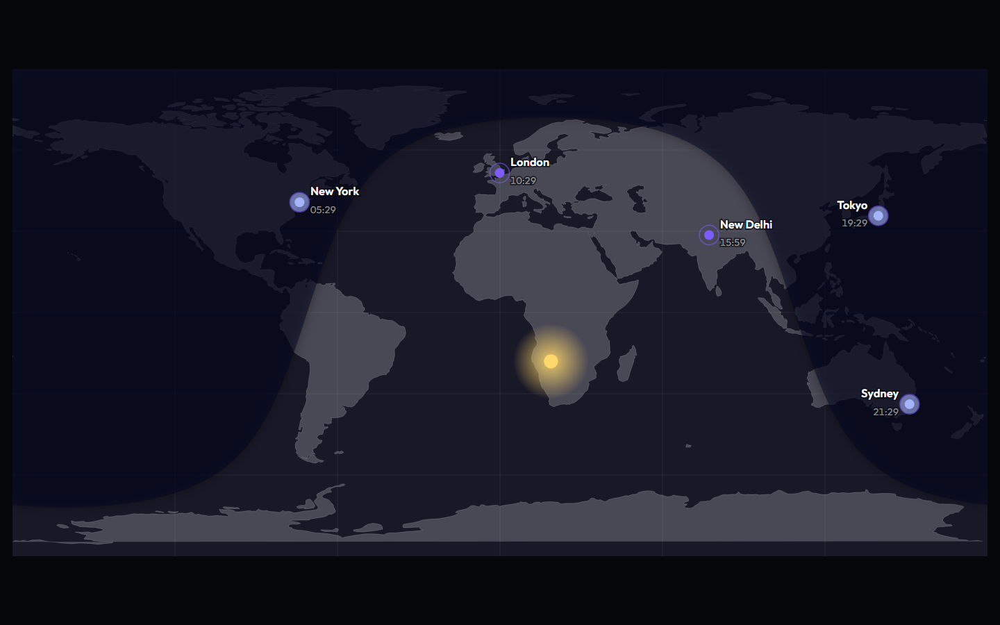 **World map** |
| 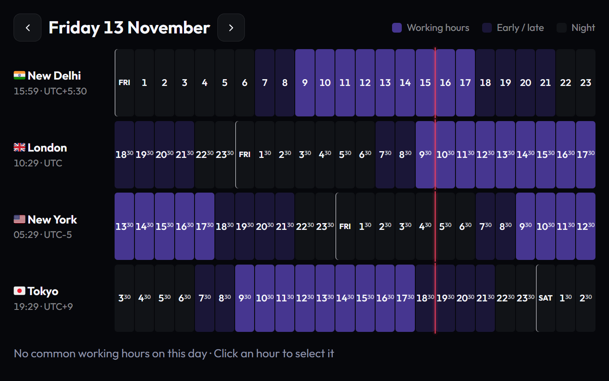 **Meeting planner** | 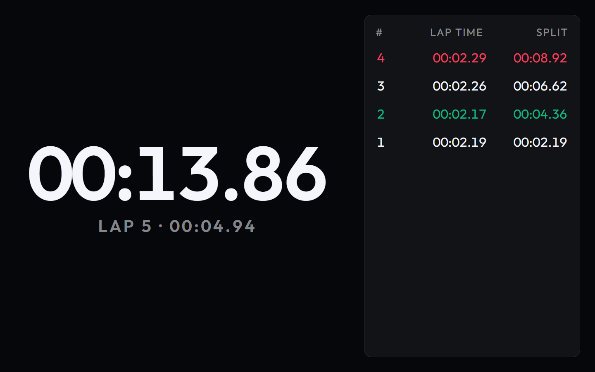 **Stopwatch with laps** |
| 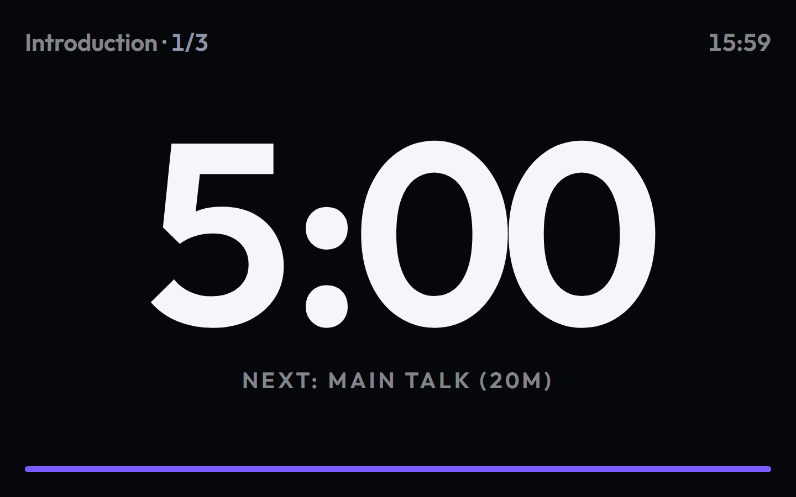 **Presenter / stage timer** | 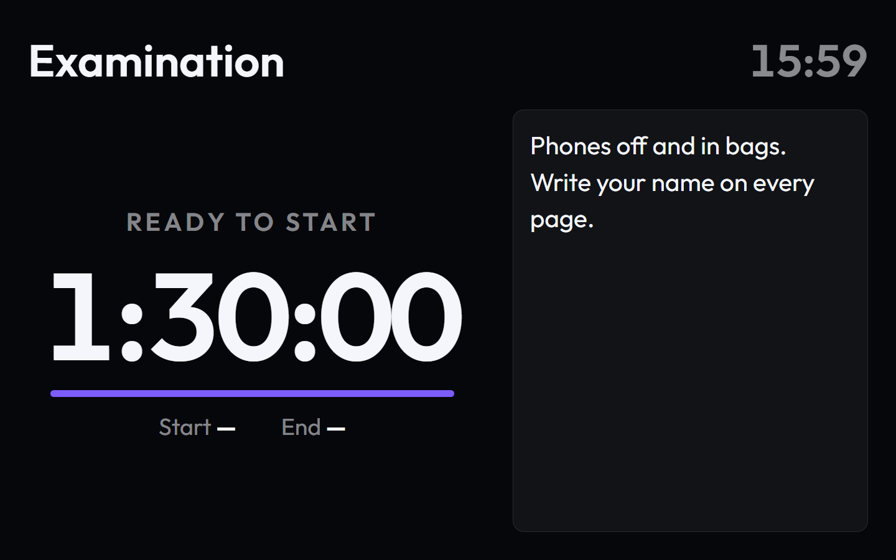 **Exam / classroom** |
| 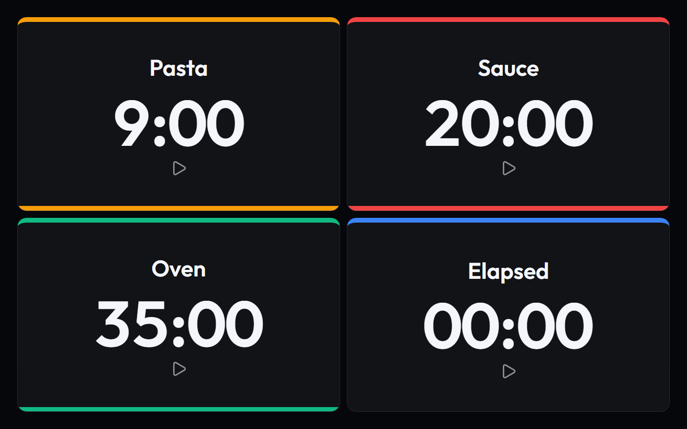 **Multi-timer** | 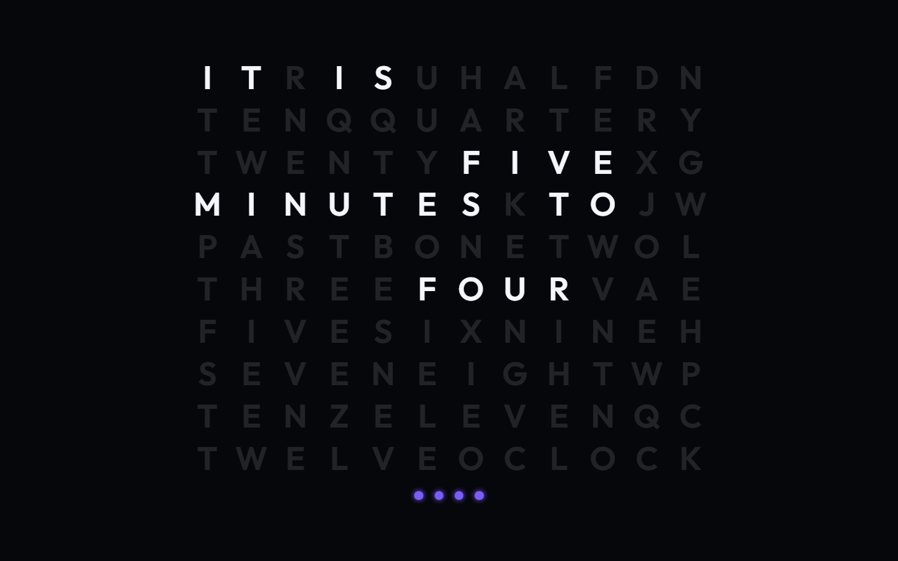 **Word clock** |
| 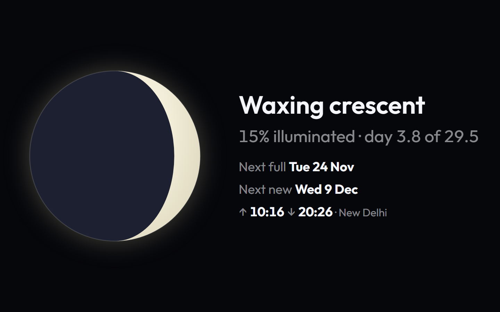 **Moon phase** | |

## Use cases

- **Classrooms and exams:** a big "time left" display with reading time, spoken milestones and a notice board.
- **Conferences and events:** a presenter or stage timer on a confidence monitor, with agenda segments and live messages to the speaker.
- **Streaming:** a transparent OBS browser-source overlay for countdowns and clocks.
- **Remote teams:** world clocks, a day/night map and a meeting planner that finds overlapping working hours.
- **Focus and workouts:** Pomodoro cycles and custom interval (HIIT) timers.
- **Offices and lobbies:** a full-screen wall clock on a spare TV, with burn-in protection.

## Display & styles

- **Present** switches the current tab to full screen. **Open display window** opens a second window (TV or projector) that stays in sync through `BroadcastChannel`, with a `localStorage` fallback.
- 7 display styles: Minimal, Glass, Neon, Flip, LED, Aurora and High contrast. Each works in light and dark, with an accent colour, 4 bundled fonts, a size slider, and a solid, gradient or image background.
- Screen Wake Lock, cursor and controls auto-hide, burn-in pixel shift, large-touch mode with swipe between modes.

## Keyboard shortcuts

| Key | Action |
|---|---|
| `Space` | Start / pause |
| `R` | Reset |
| `L` | Lap |
| `↑` / `↓` | ±1 minute |
| `N` / `P` | Next / previous segment |
| `PgDn` / `PgUp` | Presentation clicker |
| `F` | Full screen |
| `T` | Toggle theme |
| `H` | 12h / 24h |
| `?` | Help |

## Sharing, second screen & OBS overlay

- **Share link:** the whole setup is compressed into `#/display?s=…`. The link opens isolated from local settings, and a QR code is shown for phones.
- **OBS overlay:** add `&embed=1&bg=transparent`, plus optional `&scale=`, `&align=` and `&color=`.
- **Presets:** saved in `localStorage`, with JSON export and import.

## Privacy

Everything runs locally in your browser. There is no backend, no sign-up, no analytics and no cookies. Settings and presets stay in your browser's `localStorage`, and a share link only contains the setup you chose to share.

## How time is kept

Timers never accumulate `setInterval` ticks. A running timer stores `{ anchor, acc }`, and elapsed time is `acc + (now - anchor)`. That keeps it accurate in throttled background tabs, after a reload, and across synced windows. Timer events (end, warnings, phase changes, exam milestones) are derived from this state in `src/lib/signals.ts` and fire once per window. Only the display window, or the dashboard when no display is open, plays sound.

## Development

Requires Node.js 20.19+ (CI uses Node 24).

```bash
npm install
npm run dev        # http://localhost:5173
npm test           # vitest: time math, DST, meeting overlap, alarms, solar/moon, signals
npm run lint
npm run build      # → dist/ (static, base './')
```

### Structure

```
src/
  lib/        pure logic: time, tz, solar, alarms, sequence, signals, share, sync, audio
  store/      zustand store (persist + cross-window sync), actions, defaults
  modes/      one file per mode: Display + Settings (lazy-loaded)
  components/ DeckView (display shell), ControlBar, Engine (events/alarms), UI primitives
  dashboard/  dashboard page + panels      display/  full-screen page
  i18n/       t('key', 'English') with es / fr / de dictionaries
  styles/     tokens, dashboard, deck styles, per-mode layouts
```

Built with React 19, TypeScript, Vite, Zustand, SCSS and `vite-plugin-pwa`.

## Deployment

Every push to `main` runs [`.github/workflows/deploy.yml`](.github/workflows/deploy.yml), which installs dependencies, runs the tests, builds `dist/` and publishes it to GitHub Pages at **https://chrisjdj.github.io/Time-Deck/**.

One-time setup: **Settings → Pages → Build and deployment → Source: GitHub Actions**.

The build uses relative paths (`base: './'`), so `dist/` can also be hosted from any static server or sub-folder.

## Contributing

Issues and pull requests are welcome. See [CONTRIBUTING.md](CONTRIBUTING.md) for setup, checks, and how to add a language or a mode.

## Credits

- Land outlines: Natural Earth via [world-atlas](https://github.com/topojson/world-atlas) (public domain)
- Sun/moon times: [SunCalc](https://github.com/mourner/suncalc) (BSD-2)
- Flag glyphs on Windows: [Twemoji Country Flags](https://github.com/talkjs/country-flag-emoji-polyfill) (CC-BY 4.0, Twitter/Twemoji)
- Icons: [Lucide](https://lucide.dev) (ISC)

## License

[MIT](LICENSE)
